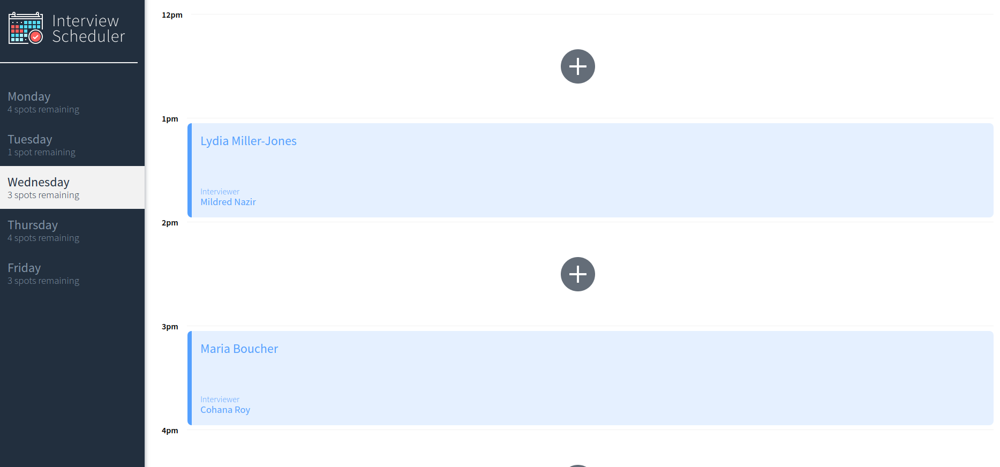
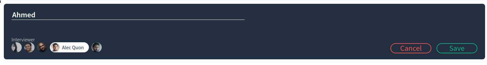
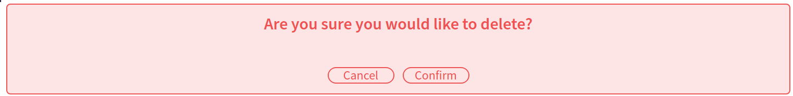

# Interview Scheduler — Historical deployment repository

This repository contains a **historical deploy/build copy** of the [Interview Scheduler React project](https://github.com/achau11/scheduler). For the project overview, development notes and source-oriented documentation, start with the main `scheduler` repository.

> This repository includes old build output and was used for a previous deployment experiment. The historic external demo addresses are **not verified as currently available**. It is not an actively maintained hosted service.

## What the app demonstrates

- React interface for viewing and managing interview appointments
- HTTP communication with a separate API backed by PostgreSQL
- UI test setup with Jest and Storybook

## Screenshots

| Appointments | Details |
| --- | --- |
|  |  |

| Edit appointment | Delete confirmation |
| --- | --- |
|  |  |

## Running code

For the most meaningful source and setup instructions, see [achau11/scheduler](https://github.com/achau11/scheduler). This old deployment snapshot may need dependency, environment, and backend configuration changes to run.
